

# ⚛︎ 量子力学与弦论 · 五人辩论课件

**Quantum Mechanics & String Theory — an interactive bilingual web course**

一份带动画的中英双语网页课件，写给聪明的非物理学家：先给结论，再用动画和实验补证据。

### 👉 [在线打开 / Live demo](https://zhangxiaoxi2025.github.io/quantum-strings-courseware/) 👈

> [!IMPORTANT]
> **这是一份 AI 辅助制作的科普课件，不是原创研究。** 内容经过几轮 AI 互相核对，**未经物理专业人士审阅**，如发现错误欢迎提 Issue。
> 课件里爱因斯坦、孔子、王阳明、卢梭、苏格拉底的对话是**角色扮演**，不是历史原话；只有明确标注「出处」的句子才是真实引语。
>
> **This is an AI-assisted popular-science courseware, not original research.** It was cross-checked by AI agents over several rounds, **not reviewed by a physicist**. The characters' dialogue is role-play, not historical quotes, except the lines explicitly marked with a source.

---

## 这是什么

五个人物围坐一桌，辩论量子力学和弦论到底证实了什么、还在争什么、完全没有证据的又是什么。苏格拉底在封面先给出三句话总纲：

1. **量子力学**已被实验反复确认，争的只是**如何解释**。
2. **广义相对论**与**量子力学**在**黑洞**和**大爆炸**处打架。
3. **弦论**是目前呼声最高的和事佬，但**至今没有实验作证**。

后面每一节都在给这三句话补证据，并在节末用一张 **已证实 / 有争议 / 未证实** 三栏表收尾。

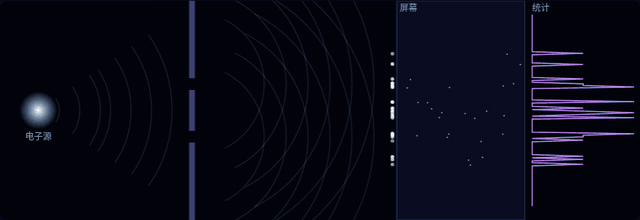 
双缝动画（示意，比例非真实）：前半段观测器关 → 干涉条纹；后半段观测器开（记录路径）→ 两条亮带。

## 内容一览（7 页）

| 页 | 标题 | 主要内容 |
|---|---|---|
| 0 | 总纲 | 苏格拉底三句话总纲；五位角色介绍；角色扮演说明 |
| 1 | 什么是测量 | 双缝实验（可开关观测器）；“坍缩”动画（标注为哥本哈根诠释的讲法，多世界诠释里没有坍缩）；C₆₀ 富勒烯干涉（Arndt 等，Nature 1999）；加热 C₇₀ 的热退相干（Hackermüller 等，Nature 2004） |
| 2 | 叠加是无知还是天性？ | 贝尔不等式示意图；代尔夫特无漏洞贝尔实验（Hensen et al., Nature 2015：S = 2.42 ± 0.20，245 次有效试验）；诠释之争 |
| 3 | 两大理论为什么打架 | 时空泡沫缩放动画；不可重整化；普朗克尺度 |
| 4 | 弦论怎么调停 | 弦的三种振动模式动画；花园水管类比（额外维度缩放）；弦论振幅在微扰计算中普遍认为有限，所有阶的严格证明尚未完成；弦论的理论成果 |
| 5 | 它还欠哪些证据 | 能标对比图（LHC ~10⁴ GeV vs 普朗克能量 ~10¹⁹ GeV）；LHC 搜寻过大额外维度、微型黑洞，至今没找到；超对称；景观问题 |
| 6 | 一页回顾 + 思考题 | 全课回顾；3 道可展开答案的思考题 |

第 1–5 节末尾附有“延伸观看”卡片（YouTube / B站 / 网页链接）。

## 功能

- 🎞️ **Canvas 动画**：双缝逐粒子累积、测量“坍缩”、时空泡沫缩放、弦振动模式、水管额外维度缩放等
- 🌐 **中 / EN 一键切换**：所有正文、按钮、图注都有中英两版
- 🔇 **声音默认关闭**：可开启 Web Audio 实时合成的环境音、翻页提示音、双缝粒子落屏声（无音频文件）
- 📦 **单个离线 HTML 文件**：`index.html` 约 95 KB，不依赖外部脚本、字体或图片；下载后断网也能打开（只有延伸观看链接需要联网）
- ⌨️ **键盘翻页**：`←` `→` / `PgUp` `PgDn` / 滚轮 / 右侧圆点导航 / 右下角按钮
- 📱 适配手机竖屏

## 截图

| | |
|---|---|
| 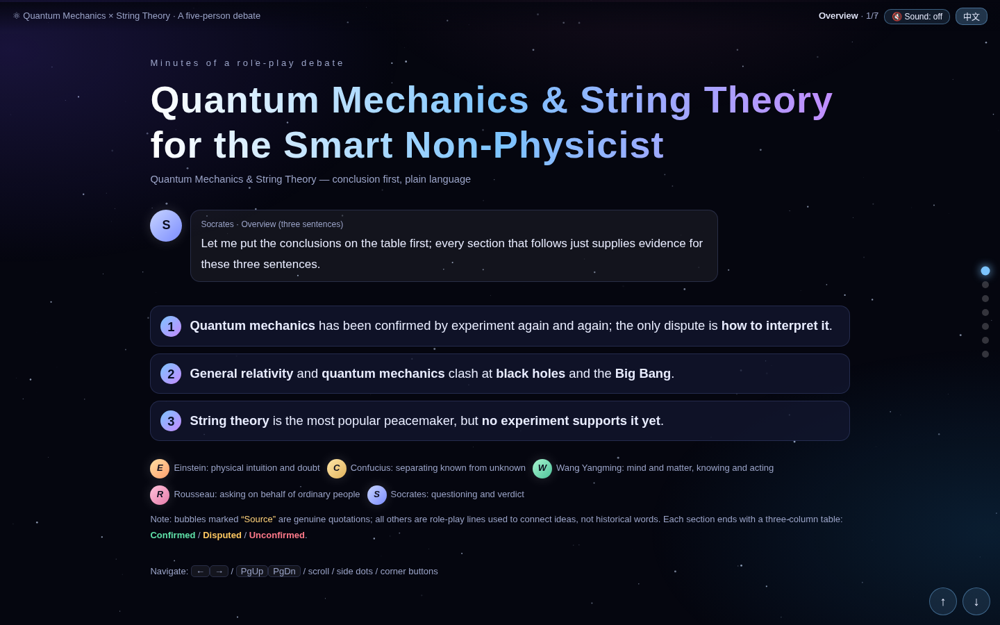 封面（English） | 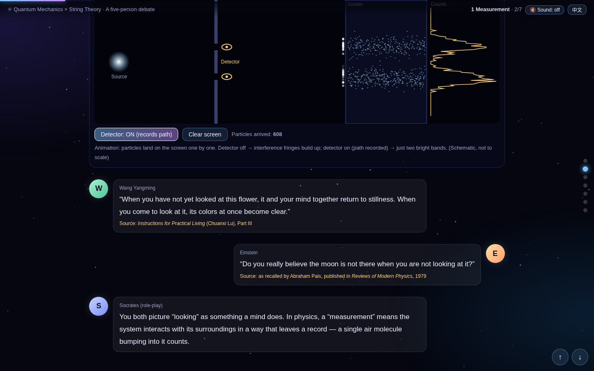 双缝实验（English） |
| 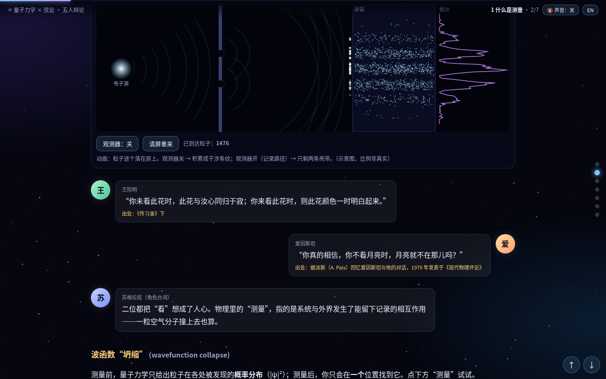 双缝：观测器关 → 干涉条纹 | 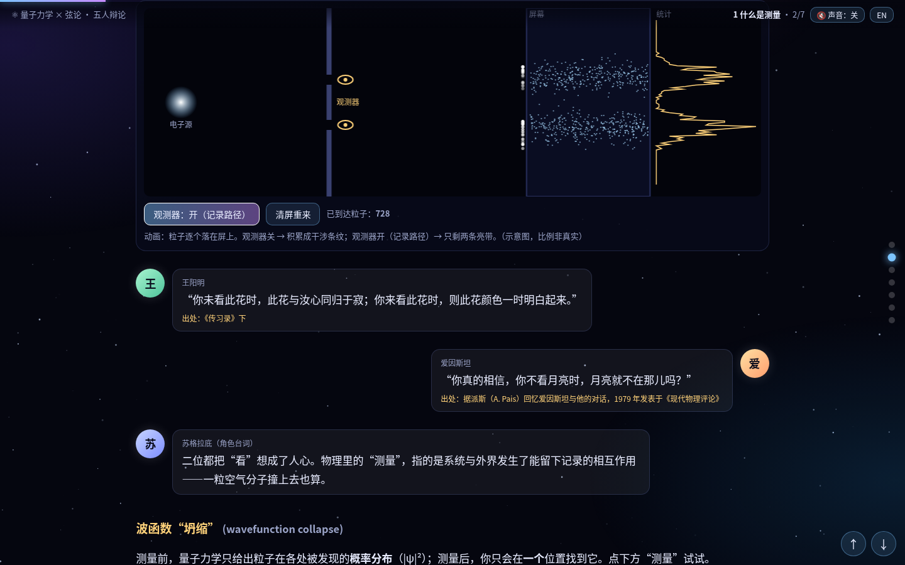 双缝：观测器开 → 两条亮带 |
| 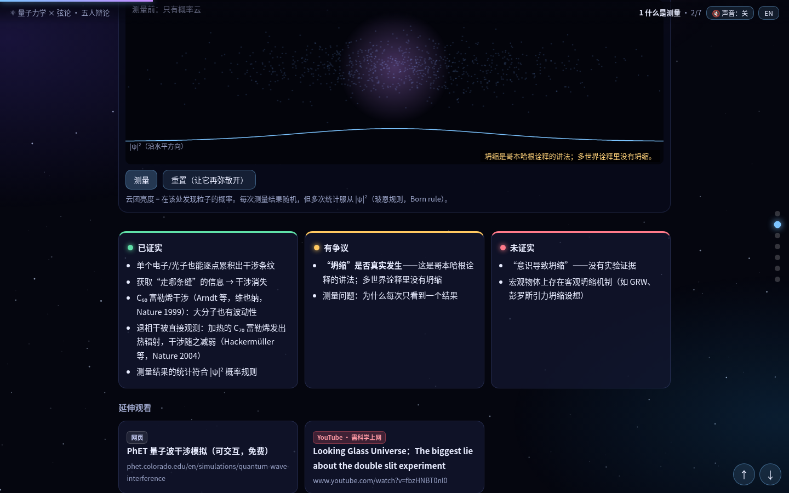 测量前：只有概率云 | 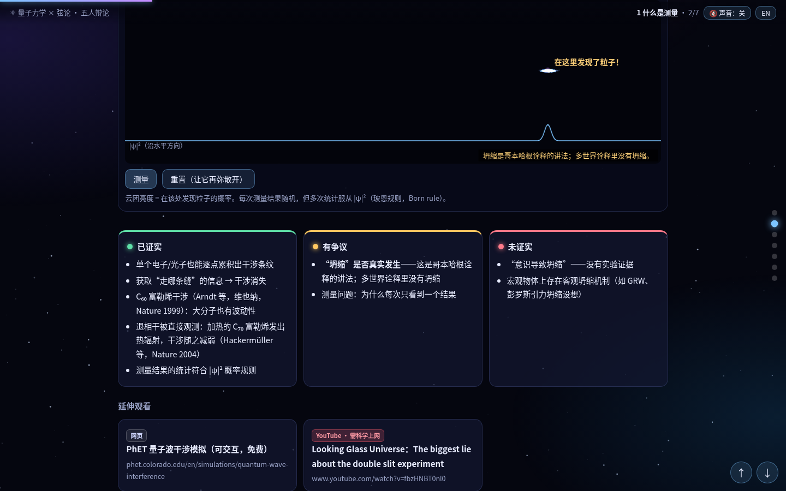 测量后（哥本哈根诠释的讲法）+ 三栏表 |
| 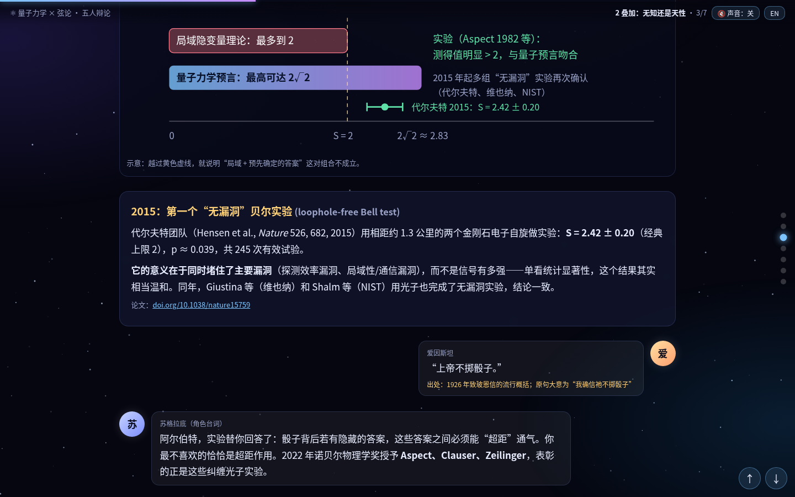 贝尔实验：代尔夫特 2015 | 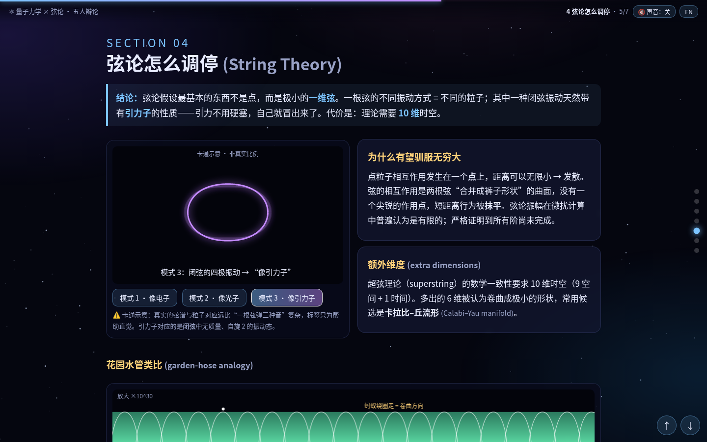 弦的振动模式 |
| 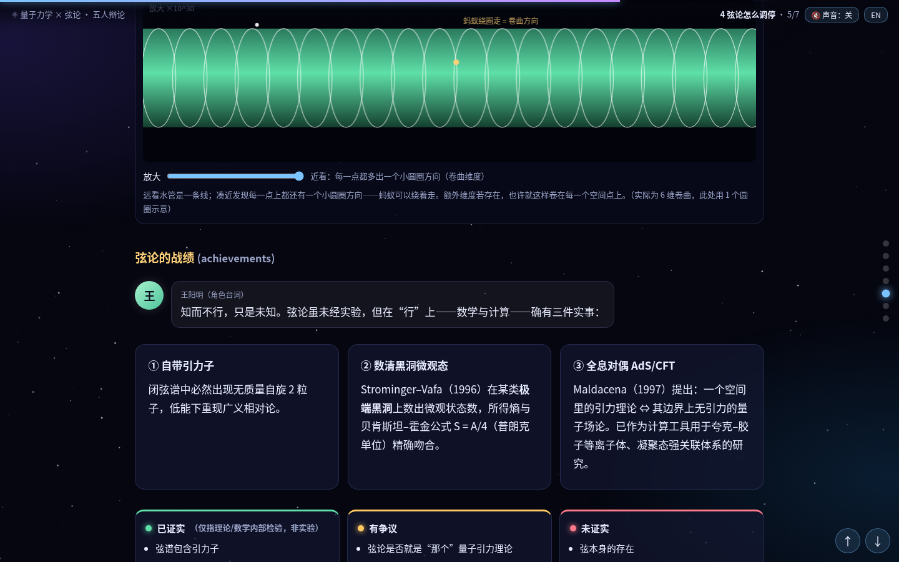 花园水管类比：放大后出现卷曲维度 | 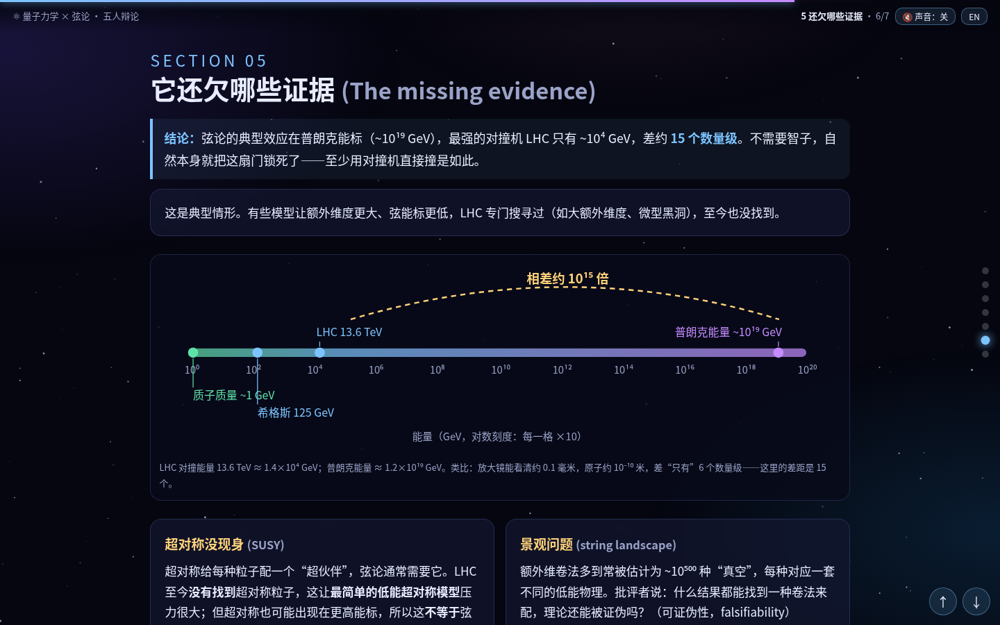 还欠哪些证据：能标相差约 10¹⁵ 倍 |
| 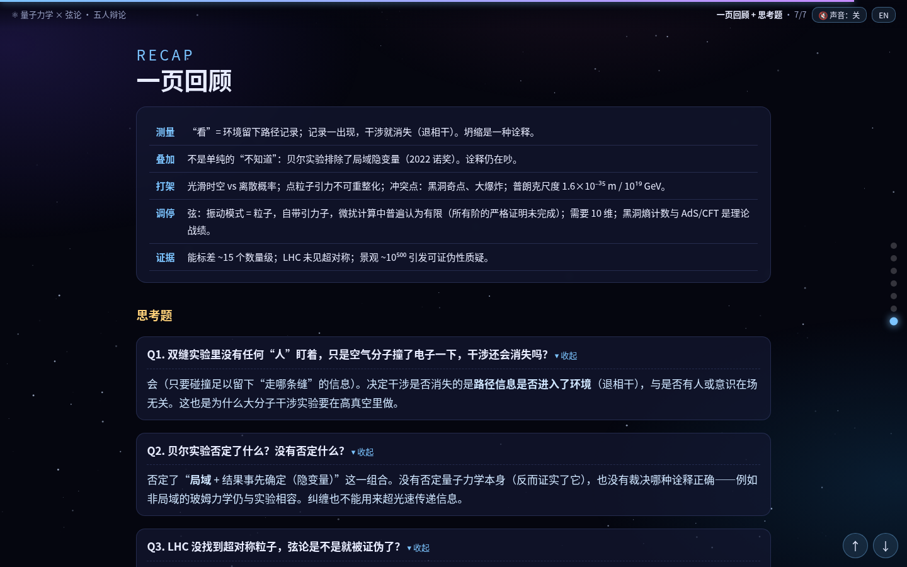 一页回顾 + 思考题 | 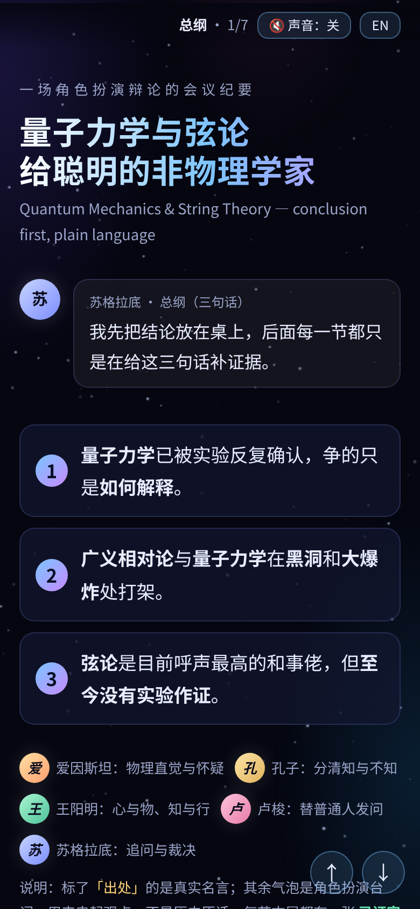 手机竖屏 |

## 怎么用

- **在线**：打开 <https://zhangxiaoxi2025.github.io/quantum-strings-courseware/>
- **离线**：下载本仓库的 [`index.html`](index.html)（页面右上角 *Raw* → 另存为），双击用浏览器打开即可。推荐较新的 Chrome / Edge / Firefox / Safari。

## 准确性说明

课件的立场是“实事求是”：每节都把说法分成三类。以下为课件中的部分示例：

- ✅ **已证实**：单个粒子逐点累积出干涉条纹；获取“走哪条缝”的信息会让干涉消失；C₆₀ 大分子干涉；加热 C₇₀ 的热退相干；局域隐变量理论被贝尔实验排除。
- 🟡 **有争议**：“坍缩”是否真实发生（这是哥本哈根诠释的讲法，多世界诠释里没有坍缩）；哪种诠释正确；弦论是否就是“那个”量子引力理论；微扰振幅是否到所有阶都有限（普遍认为有限，严格证明尚未完成）。
- 🔴 **未证实**：“意识导致坍缩”（没有实验证据）；任何量子引力理论的实验证据；普朗克尺度的时空是否离散/“泡沫化”；弦本身的存在、额外维度、超对称粒子（LHC 搜寻过大额外维度、微型黑洞，至今未见）。

**关于角色扮演**：五位历史人物的台词是为了串起观点而虚构的，不代表他们真的说过或会这样主张。课件中标有「出处」的才是真实引语（如《论语·为政》《传习录》、派斯回忆的爱因斯坦对话、爱因斯坦 1926 年致玻恩信的流行概括，课件里注明了它是概括而非原句）。

**动画均为示意图**，比例和细节不代表真实物理尺度。

## 主要参考

- Hensen, B. et al. *Loophole-free Bell inequality violation using electron spins separated by 1.3 kilometres.* **Nature** 526, 682 (2015). doi: [10.1038/nature15759](https://doi.org/10.1038/nature15759)
- 课件中还以文字形式引用了：Arndt 等（C₆₀ 干涉，Nature 1999）；Hackermüller 等（C₇₀ 热退相干，Nature 2004）；Giustina 等（维也纳）与 Shalm 等（NIST）2015 年光子无漏洞贝尔实验；Strominger–Vafa (1996)；Maldacena (1997)。
- 延伸观看与网页资源（PhET、Nobel Prize、Wikipedia、YouTube、B站等）的链接见课件各节末尾。

## 制作

由 **Xiaoxi Zhang（麻醉医师）** 在 AI 智能体协助下制作。物理内容经过几轮 AI 互相核对，未经物理专业人士审阅。

## 许可

- **代码**（HTML / CSS / JavaScript）：[MIT License](LICENSE)
- **文字内容与截图**：[CC BY 4.0](LICENSE-CONTENT)
- 课件中链接到的第三方视频与网页，版权归其各自所有者，不在上述许可范围内。

---

## English

**An interactive, bilingual (中文 / English) web course on quantum mechanics and string theory for smart non-physicists**, told as a role-play debate among Einstein, Confucius, Wang Yangming, Rousseau and Socrates.

### 👉 [Live demo](https://zhangxiaoxi2025.github.io/quantum-strings-courseware/) — click **EN** in the top-right corner to switch language.

> This is an **AI-assisted popular-science courseware, not original research**. It was cross-checked by AI agents over several rounds, **not reviewed by a physicist**. The characters' dialogue is role-play, not historical quotes, except the lines explicitly marked with a source. Corrections are welcome via Issues.

**Socrates' three-sentence overview**

1. Quantum mechanics has been confirmed by experiment again and again; the dispute is only about how to interpret it.
2. General relativity and quantum mechanics clash at black holes and the Big Bang.
3. String theory is the most promising peacemaker, but still has no experimental support.

**Seven pages:** Overview · 1 What is a measurement (double slit with detector toggle; collapse animation labelled as Copenhagen wording — many-worlds has no collapse; C₆₀ interference, Arndt et al. 1999; C₇₀ thermal decoherence, Hackermüller et al. 2004) · 2 Superposition: ignorance or nature? (Bell; Hensen et al., Nature 2015, S = 2.42 ± 0.20, 245 trials) · 3 Why GR and QM clash (spacetime foam, non-renormalizability) · 4 String theory (vibration modes, garden-hose analogy for extra dimensions; amplitudes widely believed finite in perturbation theory, all-order proof incomplete) · 5 The missing evidence (energy-scale chart; LHC searched for large extra dimensions and micro black holes, found nothing) · Recap + 3 quiz questions.
Every section ends with a **Confirmed / Disputed / Unconfirmed** table; sections 1–5 have “further viewing” cards (YouTube / Bilibili / web).

**Features**

- Canvas animations (double slit, collapse, spacetime foam, string modes, garden-hose zoom); all are schematic, not to scale
- One-click 中 / EN toggle covering all text
- Sound **off by default**; optional ambient sound, page chime and double-slit ticks synthesized live with Web Audio
- A single self-contained offline HTML file (~95 KB, no external scripts, fonts or images)
- Keyboard navigation: `←` `→` / `PgUp` `PgDn`, plus mouse wheel, side dots and corner buttons; works on mobile

**How to use:** open the live demo, or download [`index.html`](index.html) and open it in any modern browser (works offline; only the external video/web links need a connection).

**Key reference:** Hensen, B. et al., *Nature* 526, 682 (2015), doi: [10.1038/nature15759](https://doi.org/10.1038/nature15759). Other works are cited by name in the courseware.

**Credits:** made by **Xiaoxi Zhang** (anesthesiologist) with AI agent assistance.

**License:** code under [MIT](LICENSE); text and screenshots under [CC BY 4.0](LICENSE-CONTENT). Linked third-party videos and web pages belong to their respective owners.
